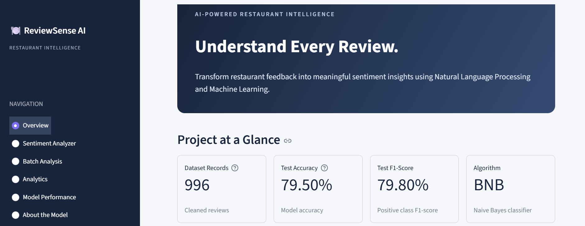
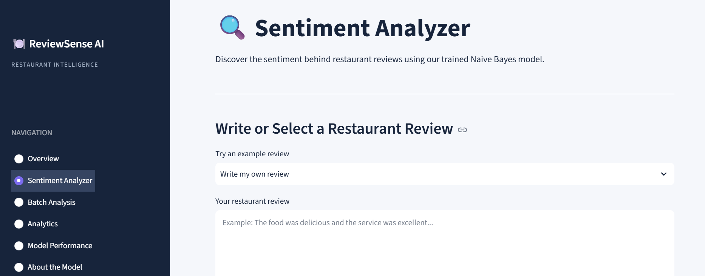
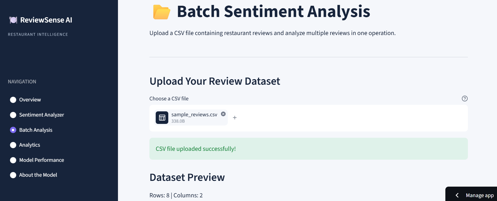
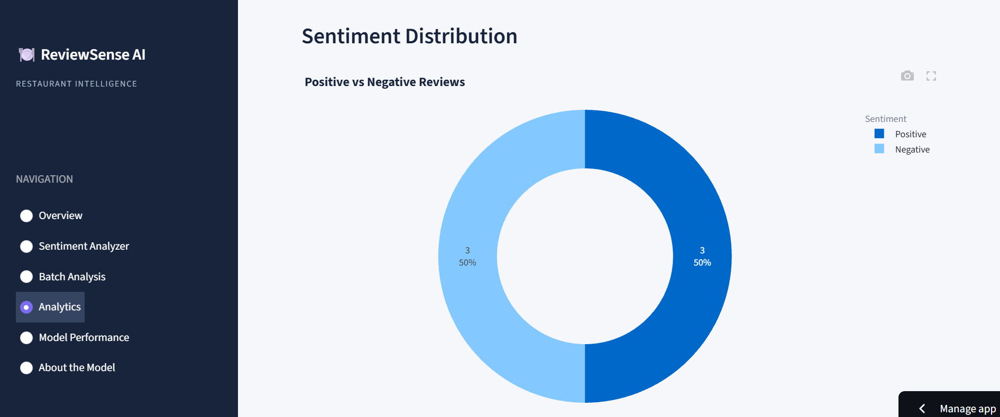
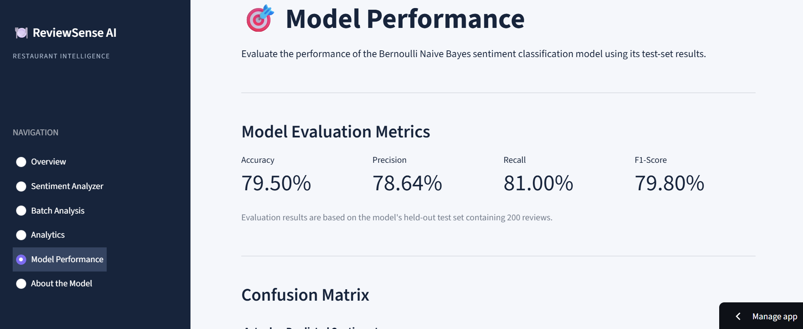
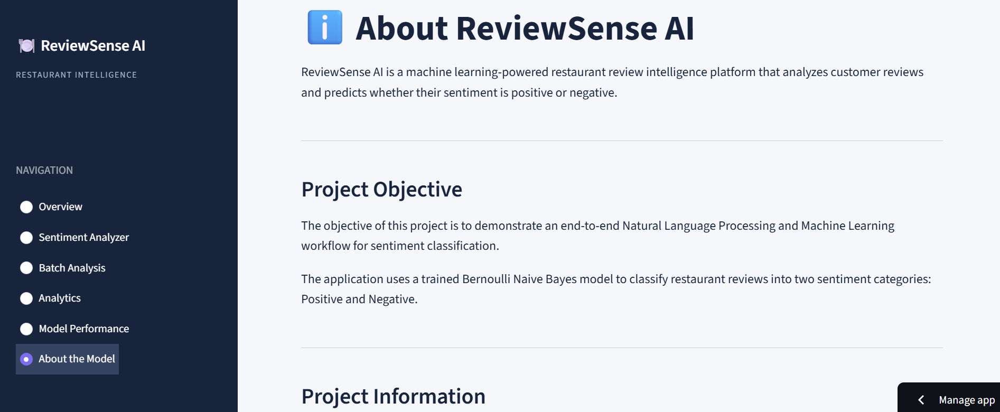
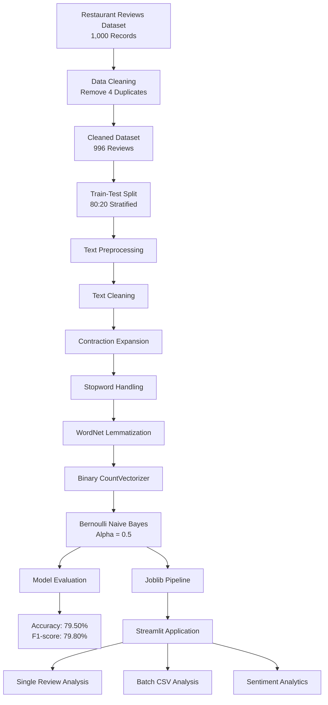

# 🍽️ ReviewSense AI – Restaurant Review Intelligence Platform

An end-to-end Natural Language Processing and Machine Learning application that analyzes restaurant reviews and predicts customer sentiment using **Bernoulli Naive Bayes**.

<p align="center">

  **[🚀 Live Demo](https://reviewsense---ai.streamlit.app)**
  ·
  **[💻 GitHub Repository](https://github.com/yaswanth1523/ReviewSense---AI)**

</p>

---

## 📌 Project Overview

ReviewSense AI is a machine learning-powered restaurant review intelligence platform designed to classify customer reviews into two sentiment categories:

- 😊 **Positive**
- 😞 **Negative**

The application uses a trained Bernoulli Naive Bayes model with a Natural Language Processing pipeline to transform raw customer reviews into binary numerical features and generate sentiment predictions.

The platform provides an interactive interface for individual review analysis, batch CSV processing, sentiment analytics, and model performance evaluation.

## 🎯 Project Objectives

- Build an end-to-end NLP sentiment classification workflow.
- Apply text cleaning, contraction expansion, stopword handling, and lemmatization.
- Convert processed text into binary numerical features.
- Train and evaluate a Bernoulli Naive Bayes classifier.
- Develop an interactive Streamlit application.
- Generate sentiment insights through interactive visualizations.
- Deploy the application using Streamlit Community Cloud.

## ✨ Application Features

### 1. Overview Dashboard
- Project introduction and key performance indicators.
- Machine learning workflow overview.
- Model and dataset information.

### 2. Sentiment Analyzer
- Analyze individual restaurant reviews.
- Select sample reviews or enter custom text.
- Predict positive or negative sentiment.
- Display estimated class probabilities.
- Maintain session-based analysis history.

### 3. Batch Analysis
- Upload restaurant review datasets in CSV format.
- Select the review column.
- Generate predictions for multiple reviews.
- Display estimated negative and positive probabilities.
- Download processed results as a CSV file.

### 4. Sentiment Analytics
- Explore positive and negative sentiment distributions.
- Visualize sentiment comparisons.
- Analyze estimated class probability distributions.
- Compare individual and batch analysis results.

### 5. Model Performance
- Accuracy, precision, recall, and F1-score.
- Confusion matrix visualization.
- Correct and incorrect prediction analysis.
- Interpretation of model performance.

### 6. About the Model
- Dataset information.
- Text preprocessing workflow.
- Model configuration.
- Limitations and future improvements.


## 🖥️ Application Screenshots

### Overview Dashboard


### Sentiment Analyzer


### Batch Analysis


### Sentiment Analytics


### Model Performance


### About the Model



## 📊 Dataset Information

| Description | Value |
|---|---:|
| Original records | 1,000 |
| Duplicate records removed | 4 |
| Final records | 996 |
| Input features | Review |
| Target variable | Liked |
| Negative class | 0 |
| Positive class | 1 |

The dataset contains restaurant reviews labelled as positive or negative.

The cleaned dataset contains 497 negative reviews and 499 positive reviews.

## 🏗️ System Architecture

The following diagram illustrates the end-to-end workflow
of ReviewSense AI, from dataset preparation to deployment.



## ⚙️ Machine Learning Workflow

The project follows an end-to-end machine learning pipeline:

1. Dataset loading and inspection.
2. Duplicate removal and data cleaning.
3. Train-test splitting.
4. Text preprocessing.
5. Feature extraction using Binary CountVectorizer.
6. Model training using Bernoulli Naive Bayes.
7. Hyperparameter tuning using GridSearchCV.
8. Model evaluation.
9. Pipeline serialization using Joblib.
10. Streamlit application development and deployment.

## 🧹 Text Preprocessing

The preprocessing pipeline includes:

| Step | Description |
|---|---|
| Text Cleaning | Normalize and clean raw review text |
| Contraction Expansion | Expand contractions into their full forms |
| Stopword Handling | Remove selected stopwords while preserving important sentiment words |
| Lemmatization | Basic WordNet noun lemmatization |
| Feature Extraction | Binary CountVectorizer representation |

**Feature representation:**

- `0` – Word absent
- `1` – Word present

## 🤖 Model Development

**Selected Algorithm:** Bernoulli Naive Bayes

| Parameter | Configuration |
|---|---|
| Algorithm | Bernoulli Naive Bayes |
| Feature Extraction | Binary CountVectorizer |
| N-gram Range | (1, 1) |
| Alpha | 0.5 |
| Cross-validation | 5-fold GridSearchCV |
| Best CV Macro F1 | Approximately 79.59% |

The selected model combines basic WordNet noun lemmatization, binary word-presence features, and Bernoulli Naive Bayes classification.

## 📈 Model Evaluation Results

The selected model was evaluated on a test set containing 200 reviews.

| Evaluation Metric | Score |
|---|---:|
| Accuracy | 79.50% |
| Precision | 78.64% |
| Recall | 81.00% |
| F1-score | 79.80% |

### Confusion Matrix

| Actual / Predicted | Negative | Positive |
|---|---:|---:|
| Negative | 78 | 22 |
| Positive | 19 | 81 |

- True Negatives: 78
- False Positives: 22
- False Negatives: 19
- True Positives: 81

The model correctly classified 159 out of 200 test reviews.

**Evaluation note:** The test set was used during earlier exploratory comparisons of candidate model configurations. Therefore, these results should be interpreted as observed test-set performance rather than a completely untouched final evaluation.

## 🛠️ Technology Stack

| Category | Technologies |
|---|---|
| Programming Language | Python |
| Data Processing | Pandas, NumPy |
| NLP | NLTK |
| Machine Learning | Scikit-learn |
| Feature Extraction | CountVectorizer |
| Model Serialization | Joblib |
| Data Visualization | Plotly |
| Application Framework | Streamlit |
| Version Control | Git, GitHub |
| Deployment | Streamlit Community Cloud |

## 📁 Project Structure

```text
restaurant-review-sentiment/
│
├── .streamlit/
│   └── config.toml
│
├── app.py
├── preprocessing.py
├── sentiment_pipeline.joblib
├── requirements.txt
├── .gitignore
├── test_model.py
└── test_preprocessing.py
```

## 🚀 Run the Application Locally

### 1. Clone the repository

```bash
git clone https://github.com/yaswanth1523/ReviewSense---AI.git
```

### 2. Navigate to the project directory

```bash
cd ReviewSense---AI
```

### 3. Create a virtual environment

```bash
python -m venv .venv
```

### 4. Activate the virtual environment

**Windows:**

```bash
.venv\Scripts\activate
```

### 5. Install dependencies

```bash
python -m pip install -r requirements.txt
```

### 6. Run the Streamlit application

```bash
streamlit run app.py
```

The application will open in your browser, usually at:

```text
http://localhost:8501
```

**Note:** The preprocessing module uses NLTK resources, including Stopwords and WordNet. Ensure the required NLTK resources are available in your environment.

## ⚠️ Model Limitations

- The training dataset contains only 996 reviews.
- Bag-of-Words features do not fully capture sentence context.
- Sarcasm and complex sentence structures can be difficult to interpret.
- Mixed-sentiment reviews may be misclassified.
- The model is primarily trained for restaurant review classification.
- Predicted probabilities have not been independently calibrated.

## 🔮 Future Improvements

- Expand the training dataset with more diverse restaurant reviews.
- Experiment with TF-IDF and word or sentence embeddings.
- Explore Logistic Regression, Support Vector Machines, and transformer-based models.
- Improve sarcasm, negation, and mixed-sentiment detection.
- Evaluate probability calibration using an independent evaluation dataset.
- Introduce multilingual sentiment analysis.

## 🌐 Live Application

Try ReviewSense AI here:

**[Launch ReviewSense AI](https://reviewsense---ai.streamlit.app)**

## 👨‍💻 Author

**Yaswanth Kumar Reddy M**

Aspiring Data Scientist | Machine Learning | NLP | Data Analytics

- **GitHub:** [yaswanth1523](https://github.com/yaswanth1523)
- **Project Repository:** [ReviewSense AI](https://github.com/yaswanth1523/ReviewSense---AI)
- **Live Application:** [ReviewSense AI – Streamlit](https://reviewsense---ai.streamlit.app)

---

⭐ If you find this project interesting, consider giving the repository a star!